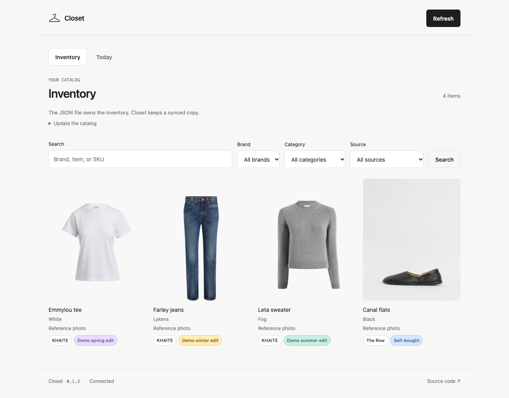

# Closet

A wardrobe inventory for Home Assistant.

Keep the catalog in TOML, with shared brands, categories and fittings. Closet
validates it, syncs changes and gives it a searchable photo grid. There is no
second inventory to maintain in the app.

Select a brand or source badge to see its inventory. The filters can also be
combined to narrow things down.
You can bookmark a filtered view or an item. Items with multiple photos have
a thumbnail gallery.
Multiple copies of the same color share one card, with sizes and sources shown
for each copy. Open a copy to see its details and tracking history.



## Install

Add this repository to the **Home Assistant App Store** and to
**Settings → Marketplace → Add from link** as an integration. On older Home
Assistant versions, use HACS:

```text
https://github.com/jessfraz/ha-closet
```

Install and start the Closet app, install the integration, and restart Home
Assistant if prompted. Confirm its discovered connection in **Settings →
Devices & services**. Enable **Show in sidebar** to open the inventory.

See the [app documentation](closet/DOCS.md) for configuration and backups.

## Keep a catalog

Start with the [fictional example](config/wardrobe.example/wardrobe.toml). Keep
the real files in your own private storage, not in a fork of this repository.

```sh
ha-closet inventory validate --input wardrobe.toml
ha-closet inventory sync --input wardrobe.toml --dry-run
```

Each purchase points to a fitting or is self-bought. Different purchases can
share a style and color without losing their own sizes or quantities.

Validation is offline. It needs no running service, credentials, or model.
Sync checks the same format and applies the whole snapshot atomically. Missing
IDs are archived, not deleted. Invalid files leave the current inventory alone.

Apply the file with one command:

```sh
ha-closet inventory sync --input wardrobe.toml
```

Local photos live in `wardrobe-images/` and are referenced by their SHA, not a
Home Assistant URL. The same command reuses or uploads them, verifies the
inventory and removes obsolete Closet-managed copies. Other Home Assistant
images are left alone; source files are never rewritten. Validation and sync
automatically resize and encode local photos for faster loading, with size and
quality limits checked before upload.

Existing JSON catalogs still work. See the [catalog format](docs/catalog.md)
and [CLI reference](docs/cli.md) for the schema and revision/retry controls.

Install the CLI from the [release](https://github.com/jessfraz/ha-closet/releases)
or with Nix. It has JSON output, optional table output, and native or
Home Assistant connections. [CLI reference](docs/cli.md).

## Garment tags

Pair an RFID tag with a garment's existing photo once. After the reading
areas are set up, put clothes where they normally go. No daily scanning or
checking things off in the app.

```text
Clean clothes in the closet
            |
       Take them out
            v
        Being worn
            |
            +--> Rewear rack ------> Ready to wear again
            +--> Laundry hamper ---> Needs laundry
            +--> Dry-cleaning bag --> Queued for dry cleaning
```

When clothes leave the hamper, or the dry-cleaning bag is taken away, Closet
counts them as being cleaned. Putting them back in the closet makes them ready
again.

```text
Leaves the hamper --> In the wash --------+
                                          |
Bag taken away -----> At the cleaners ----+
                                          |
                                 Back in the closet
                                          |
                                          v
                                    Clean / ready
```

The readers confirm movement over time, not from one missed read. If a reader
stops working, the app keeps the last status. Everything stays in the inventory;
**Ready to wear** shows the pieces in the closet or on the rewear rack.

Enrollment works on a phone or tablet, but the UHF reader detects the tags, not
the phone. Clothes that cannot comfortably take a tag can stay untagged.
Movement history stays with each physical piece, even when its tag changes.
Analytics shows wear trends and most-worn pieces, and can pick a ready piece
that has had less attention. It builds up from observed history.
Tracking starts disabled. [Setup, enrollment and recovery](docs/rfid.md).

## Today

The inventory, validation, and sync are deterministic. Today is an optional
outfit lottery. It can ask Home Assistant's configured AI Task for a few
combinations from the catalog; whether anyone wears them is another question.
Choose All for Everyday, casual Work, Evening, and Bedtime groups.
The steel-toe footwear checkbox starts off. Safety-work boots stay out of regular
suggestions; checking it uses only matching, available safety footwear.

It runs only when requested. The model gets item descriptions and, optionally,
the weather, not your photos or purchase evidence. The app checks that the
suggested pieces actually exist. No model is needed for the inventory.

## Development

```sh
nix develop
just check
```

Rust owns the API, SQLite, and CLI. Python connects it to Home Assistant.
`just security` checks dependencies; `just container` exercises restart and
backup/restore with Docker. [Contributing](CONTRIBUTING.md).

The example catalog is fictional. Screenshots use product-reference photos and
made-up shop labels, without sizes, prices, or purchase history.
[MIT](LICENSE).
